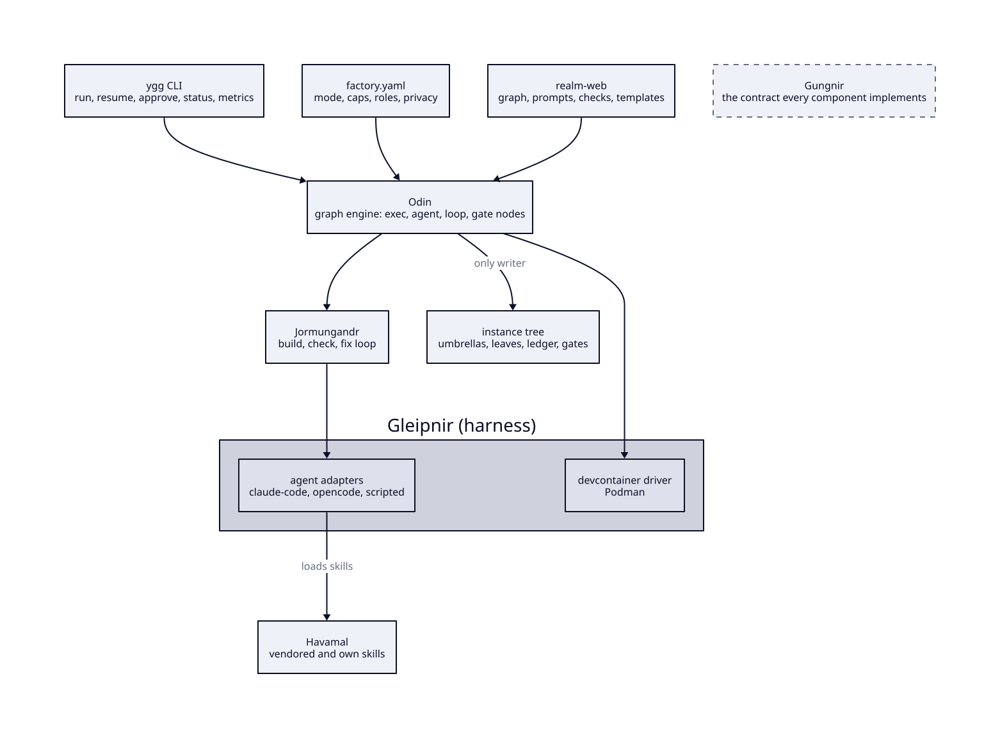
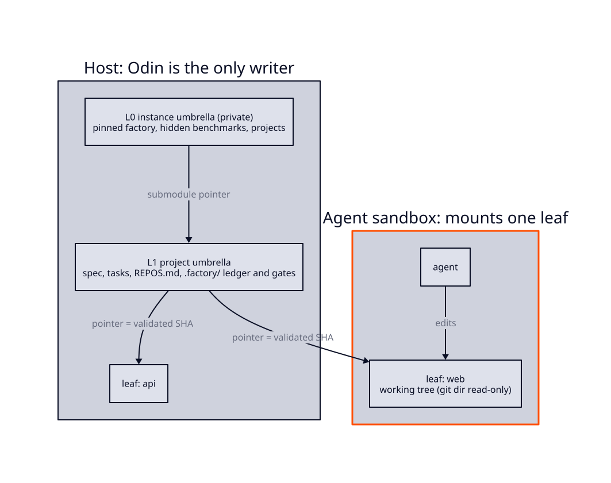
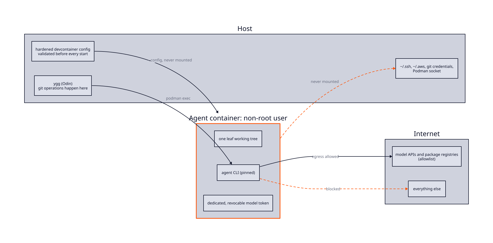
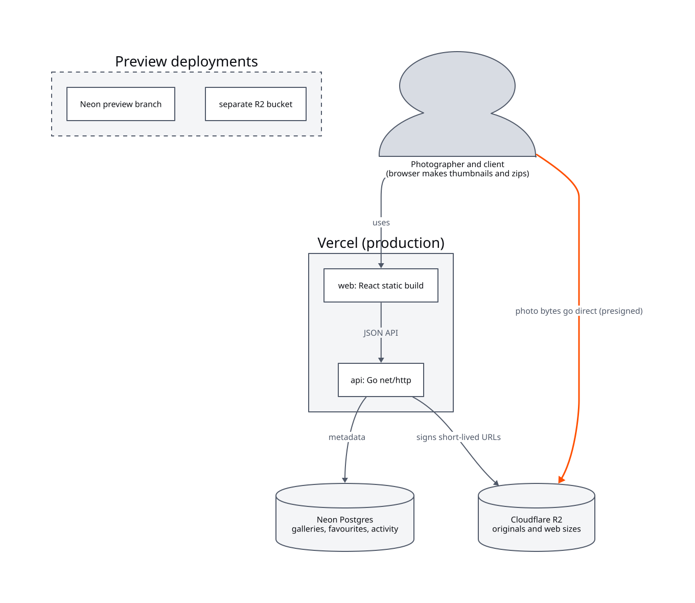

# Yggdrasil v0 engineering spec

| | |
| --- | --- |
| **Author** | Bruno Valério, with Claude Code (Opus 5.5), from brainstorming sessions held 2026-10-10 and 2026-10-11 |
| **Implements** | [v0 design doc](../../1-product/design/2026-10-11-yggdrasil-v0-design.md), within the [charter](../../1-product/charter.md) |
| **Scope** | the factory core, the web realm and metrics. The game realm and the benchmark kit (Mimir) get their own design docs and specs |
| **Deviations from the design doc** | none |
| **Research** | [`docs/5-research/`](../../5-research): harness engineering, loops/graphs/factories, orchestrator stack, web stack, hosting, curated sources |
| **Naming** | [`naming-and-mythology.md`](https://github.com/ouroboric-dev/ouroboric/blob/main/docs/7-branding/story/naming-and-mythology.md) |
| **Process** | [spec-driven development](https://github.com/ouroboric-dev/ouroboric/blob/main/docs/4-ways-of-working/spec-driven-development.md), [docs standard](https://github.com/ouroboric-dev/ouroboric/blob/main/docs/4-ways-of-working/docs-standard.md) |

## 1. Naming and repository layout

Names follow [`naming-and-mythology.md`](https://github.com/ouroboric-dev/ouroboric/blob/main/docs/7-branding/story/naming-and-mythology.md). The factory's source code is an
umbrella of repos in the `ouroboric-dev` GitHub org:

| Repo | Role |
| --- | --- |
| `yggdrasil` | umbrella: AGENTS.md, docs (specs, research, naming), `go.work`, submodule pointers. Holds no code |
| `gungnir` | the contract: Go interface types and JSON schemas (ledger events, `graph.yaml`, `pack.yaml`, `factory.yaml`) |
| `odin` | the orchestrator: graph engine and the `ygg` CLI. Routing (§8) and the ledger (§10) start as packages here |
| `gleipnir` | the harness: agent adapters, the devcontainer sandbox driver, policies, the check runner |
| `jormungandr` | the loop: build→check→fix semantics, attempts, backoff, budgets, feedback, escalation |
| `realm-web` | the web realm: graph, prompts, devcontainer stack layer, templates, checks |
| `havamal` | the skill library: vendored third-party skills with `skills.lock` and licences, our own skills with their evals, and the vendor/check/update tooling |

Yggdrasil is one product of the [Ouroboric](https://github.com/ouroboric-dev/ouroboric) company
umbrella. The company umbrella holds the company charter, the shared standards, the journal and the
branding. Yggdrasil's sibling product **Asgard**, the company factory, runs on Odin as direction
realms.

All modules are developed together through a Go workspace (`go.work`) in the umbrella. Versions MUST
be tagged only when an interface settles. Interfaces MUST live only in `gungnir`. An interface change
is then one PR in `gungnir` plus the affected components.

This source umbrella is not the operator's instance. Each operator has a private **instance
umbrella** (L0, §3) that pins a Yggdrasil version and lists their projects.

## 2. Architecture

<!-- diagram: assets/diagrams/architecture.d2 -->
<picture>
  <source media="(prefers-color-scheme: dark)" srcset="../../assets/diagrams/rendered/architecture.dark.svg">
  
</picture>

```text
                 ygg CLI  (run · resume · approve · reject · status · board · report · metrics · doctor)
                                   │
                         ┌─────────▼──────────┐
 realm (web, game…) ───► │  Odin graph engine │ ◄── factory.yaml (mode, caps, roles, privacy)
 graph.yaml, prompts,    │ exec · agent ·     │
 checks, templates       │ loop · gate nodes  │
                         └──┬────┬────┬────┬──┘
              Agent (Gleipnir) Sandbox  StateStore  Remote / Tracker
              claude-code     devcontainer files+git  local (v0)
              opencode        (k8s, hosted later)     github (iteration 2)
              scripted (tests)
                                   │
              instance tree: L0 → L1 project umbrella → L2 leaf repos
```

### 2.1 Component responsibilities

| Component | Does | Depends on |
| --- | --- | --- |
| **Odin** | loads realm graphs and `factory.yaml`; walks the graph; runs exec, agent, loop and gate nodes; checkpoints and resumes; walks the repo tree and moves pointers; writes the ledger; serves the CLI | Gungnir interfaces |
| **Gleipnir** | turns a task into an agent session (context assembly, adapter call, usage capture); runs commands in sandboxes; applies policies (devcontainer hardening, managed settings, firewall); runs checks | Gungnir; Podman and the devcontainer CLI on the host |
| **Jormungandr** | runs a bounded loop: implement → check ladder → feed failures back → retry, up to N attempts; then escalates; enforces per-loop budgets | Gungnir; called by Odin |
| **Gungnir** | defines the interfaces and schemas; validates configs | nothing |
| **realm-web** | the web recipe (§9) | Gungnir schemas |

### 2.2 Core interfaces (Gungnir)

```go
type Agent interface {
    Name() string
    Run(ctx context.Context, t Task) (Result, error)
}
// Task:   role, prompt, workdir, model, readOnly, maxTurns, timeout, envAllowlist
// Result: status, summary, usage{inTok, outTok, cacheTok, turns, costUSD, costEstimated}, transcriptPath

type Sandbox interface {
    Up(ctx context.Context, spec SandboxSpec) (Env, error)  // spec: leaf path, config path, services
    Exec(ctx context.Context, env Env, cmd Cmd) (ExecResult, error)
    Down(ctx context.Context, env Env) error                // stops everything, kills process groups
}

type StateStore interface { /* run.json, features.json, gate files, ledger append */ }
type Remote     interface { /* commit, branch, push, open PR, merge, move pointer */ }
type Tracker    interface { /* project issues/milestones/board from factory state */ }
```

The implementation plan settles the exact method sets. This section sets only the boundaries.

## 3. Repository topology and isolation

### 3.1 The instance tree

<!-- diagram: assets/diagrams/instance-tree.d2 -->
<picture>
  <source media="(prefers-color-scheme: dark)" srcset="../../assets/diagrams/rendered/instance-tree.dark.svg">
  
</picture>

The operator's instance is a **tree of nodes**. Each node is either:

- an **umbrella**: has children, holds no product code; or
- a **leaf**: holds product code; it is the only node an agent ever mounts.

```text
L0  instance umbrella (private, per operator)
    ├─ yggdrasil/          (submodule: pinned factory version)
    ├─ benchmarks/         (submodule, PRIVATE: frozen briefs + hidden suites)
    ├─ docs/
    └─ projects/<name>/    (submodules → L1, in any org)
L1  project umbrella
    ├─ AGENTS.md, docs/ (brief, spec.md, plan.md, tasks.md), REPOS.md (routing)
    ├─ .factory/ (features.json authoritative; runs/<id>/{run.json, ledger.jsonl, gates/, report.md})
    ├─ acceptance/ (cross-repo end-to-end tests)
    └─ repos/<name>/       (submodules → leaves)
L2  leaf repos (e.g. api, web)
```

Deeper trees are allowed: an umbrella's child MAY be another umbrella. The engine MUST walk the tree
recursively. The engine MUST NOT assume a fixed depth. v0 projects use L0→L1→L2. A test fixture with
an extra umbrella level proves that deeper trees work. A new level SHOULD be added only when a subtree
has its own contract and its own acceptance tests.

Every node MUST record `owner` (org or account) and `visibility`. The operator chooses visibility and
hosting per project. The factory only applies the consequences. A repo MUST NOT contain secrets or
hidden tests. If a public L0 lists private projects, the factory MUST warn the operator, because the
project names leak through `.gitmodules`.

### 3.2 Per-umbrella responsibilities

| Each umbrella owns | for |
| --- | --- |
| `AGENTS.md` invariants | its subtree; children MAY tighten them but MUST NOT loosen them |
| routing for its direct children | a generated `REPOS.md` and a routing bundle (§8) |
| integration and acceptance tests | contracts between its children, run at their pinned SHAs |
| pointer gates | moving a child's pointer only after its tests pass |

### 3.3 Isolation rules

1. **Agents MUST NOT mount an umbrella.** An implementer mounts one leaf. A planner gets a scratch
   directory with the brief. Odin commits the planner's output into L1 after the `spec` approval
   point.
2. **Odin MUST be the only writer** of umbrellas, `features.json`, the ledger, gate files and
   reports. Agents get a read-only copy of `features.json`, refreshed before each session. Odin MUST
   ignore agent edits to that copy.
3. **Agents MUST NOT commit.** Odin commits at checkpoints, from the host.
4. **Leaf git data MUST be out of reach.** A leaf's git directory lives in its parent's
   `.git/modules/<name>/`. If the git directory is mounted, it MUST be mounted read-only. Agents can
   then read `git log` and `git diff`.
5. **Host git MUST run with hooks disabled** (`-c core.hooksPath=/dev/null`). Host git MUST NOT run
   `submodule update --recursive` inside a leaf.
6. **Path-only checkout:** Odin MUST initialise only the submodules on the path from the root to the
   target leaf. Odin MUST NOT initialise submodules with `--recursive` from L0.

### 3.4 Pointer moves are the validation record

A pointer move in an umbrella means "this child, at this SHA, passed this level's checks". Rules:

- A move MUST span one level only. That level's own tests MUST pass before the move.
- A move that changes a contract (per the impact index, §8) is the `pointer-contract` approval
  point.
- The gate MUST also look at the folder of each contract the shipped impact index lists: the directory of the
  entry's path and every folder below it, except that for a contract at a leaf's root only the files directly in the
  root count. A move that changes a YAML file (`.yaml`, `.yml`) or a JSON file (`.json`) there, or a file whose git
  mode is `120000` (a symlink), whatever its name, MUST escalate. The escalation uses the evidence `inferred`, stops
  the gate in every mode, and an approved spec that holds the change MUST NOT open it. The gate's reason MUST name
  the file and the rule that selected it. A file named like a contract (`openapi.y*ml`) keeps the verdicts it has.
- A move MUST NOT propagate automatically more than one level in a single step. The operator MAY
  raise that limit explicitly.
- A sync job MUST NOT auto-merge pointers.

## 4. Run execution

### 4.1 Starting a run

`ygg run --project <path> --realm web --brief <brief.md> [--mode …]`:

1. Resolve the project's L1 umbrella. If a leaf does not exist, create it from the realm templates.
2. Write `run.json`: run id, realm and graph version, config hash, agent and model per role, graph
   position.
3. Bring up the sandboxes for each leaf (§6). Then start to walk the graph.

### 4.2 The web realm graph

<!-- diagram: assets/diagrams/software-graph.mmd -->
<picture>
  <source media="(prefers-color-scheme: dark)" srcset="../../assets/diagrams/rendered/software-graph.dark.svg">
  
</picture>

```text
design ─► [gate: design] ─► spec ─► conformance review ─► [gate: spec] ─► plan + reuse review ─► DoR check
agent                       agent    agent (read-only)                    agent + Ponytail       exec
  ─► init ─► [gate: plan] ─► for each ready task:
     agent+exec               implement ⇄ check ladder  (loop, max N)
                              └─► checkpoint ─► [gate: feature] ─► merge gate ─► [gate: merge]
                              ─► pointer move ─► [gate: pointer | pointer-contract]
  ─► final acceptance (hidden suite) ─► update living spec ─► report
```

[spec-driven development](https://github.com/ouroboric-dev/ouroboric/blob/main/docs/4-ways-of-working/spec-driven-development.md)
defines the stages and approval rules. This graph is the web realm's implementation of them.

- **design** (agent, with the operator): turns the brief into a design doc (what, for whom, why,
  scope, success criteria). By default, the `design` approval point stops for a human in every mode.
- **spec** (agent): writes the engineering spec within the design doc. A read-only
  **design-conformance reviewer** checks the spec. If there is no deviation, the spec is
  auto-approved, unless `spec: stop` is set. If there is a deviation, the run MUST stop with the
  proposed amendment.
- **plan + reuse review** (agent): writes `plan.md` and `tasks.md` in the canonical layout. The plan
  MUST record decisions as `**Decided YYYY-MM-DD:** …` lines. A Ponytail reuse review flags new
  dependencies or abstractions where the standard library or existing code already does the job.
  Odin derives `features.json` from `tasks.md`.
- **DoR check** (exec): every task MUST have acceptance criteria, a named test, a `layer/*` (which
  leaf) and a size. The sizes are S (< 100 changed lines), M (100–400) and L. An L task MUST be
  split, so it goes back to the planner. A task MUST NOT have an open blocker.
- **init** (agent + exec): scaffolds leaves from templates. It writes `init.sh` and a short
  `AGENTS.md` (about 100 lines, pointing into `docs/`). The node ends with the first commit.
- **implement ⇄ check ladder** (Jormungandr loop): each task gets one fresh agent session. The ladder
  (§9.5) runs as exec nodes plus three read-only reviewer agents. Failures go back into the next
  attempt. After N attempts (default 3), the loop escalates (§7.3).

### 4.3 Checkpoints and resume

- After each node, Odin MUST commit the workspace. Odin MUST record the node as done in `run.json`
  and the ledger. A checkpoint is a commit plus a state line.
- `ygg resume <run-id>` resets the leaf to the last checkpoint commit. Then it restarts the
  interrupted node from scratch. Every node MUST be safe to re-run.
- Odin does not attempt mid-session resume. Agent sessions are not reliably resumable across
  vendors.
- Odin MUST refuse to run on anything outside the instance tree, because a reset discards uncommitted
  work.

### 4.4 Fresh context per session

Every agent session MUST start clean. The session reads `AGENTS.md`, `progress.md`, the current task
from its read-only `features.json`, and the routing summary (§8). Nothing depends on one vendor's
session memory. This is what makes it possible to swap models mid-run.

### 4.5 The merge gate

<!-- diagram: assets/diagrams/merge-gate.mmd -->
<picture>
  <source media="(prefers-color-scheme: dark)" srcset="../../assets/diagrams/rendered/merge-gate.dark.svg">
  
</picture>

A branch can pass every check and then stop building after `main` moves underneath it. So every
`merge` and every pointer move MUST go through a merge gate. The gate is borrowed from super-board's
merge-gate script and Gas Town's Refinery:

1. **Lock** the target with a per-repo lock in `L1/.factory/locks/`. The lock matters for human edits
   now and for parallel agents later.
2. **Bring the branch up to date:** merge the current base into the branch.
3. **Re-run the checks** on the result. For a leaf merge, run ladder rungs 1–5. For a pointer move,
   run rungs 1–5 and the umbrella's acceptance tests.
4. **Merge pinned to the reviewed commit:** proceed only if the branch head is still the commit that
   was checked. Locally, compare SHAs before the fast-forward. On GitHub, use `--match-head-commit`.
   Otherwise, abort and return to the loop.
5. **Unlock** the target. Record the gate result in the ledger.

A bisecting merge queue (for batches of branches) comes with parallel agents.

### 4.6 Typed findings

Checks and reviewers report **findings**, a Gungnir type, not free text:

| Field | Meaning |
| --- | --- |
| `id` | stable across fix attempts: the same problem keeps the same id |
| `source` | which rung or reviewer raised it |
| `severity` | blocker, major, minor |
| `location` | file and line(s) |
| `claim` | what is wrong |
| `status` | open, fixed, disputed, overruled |
| `proof` | for `fixed`: the file:line evidence and the check run that confirms it. For `overruled`: the implementer's evidence and the check run that settled the dispute |

- Jormungandr feeds the open findings to the next implementer attempt. A finding MUST NOT close until
  its source confirms the fix with proof, or a dispute of it holds (`overruled`, below). The implementer's
  claim of "fixed" is not enough.
- **A reviewer's answer** MAY have prose before its report. The report MUST be the last thing in the answer,
  bare or in one code fence, and the prose MUST be ignored. Text after the report, a second fence or
  document, and an unclosed fence are malformed.
- **Disputes.** An implementer MAY dispute an open finding in its last answer of an attempt, with a
  `disputes` document. Each dispute MUST name the finding id, a check of the loop, a test id and the
  evidence. An answer with no `disputes` document disputes nothing. A malformed document MUST be recorded
  and ignored. Odin MUST decide a dispute after the loop's checks ran: it holds only when the named check
  passed in this attempt and its output contains the test id. A dispute that holds MUST close the finding as
  `overruled`, with a `finding_overruled` ledger event. A reviewer's repeat of the claim MUST NOT reopen it
  unless the report gives another location, or the check that overruled it failed in a later attempt. A
  dispute that does not hold leaves the finding open, and the next attempt MUST be told why. A check's own
  finding MUST NOT be disputed.
- **Missing or malformed data MUST NOT be defaulted.** If a reviewer output does not parse, or a
  finding has no location, it MUST be retried once as an agent failure. If it is still
  malformed, the loop MUST stop and escalate. Malformed output MUST NOT count as a pass.
- The ledger records findings per task, how many reopen, and how many attempts each finding took to
  close.

## 5. Agent adapters (Gleipnir)

v0 ships three adapters:

| Adapter | Invokes | Notes |
| --- | --- | --- |
| `claude-code` | `claude -p` with streaming JSON output | read-only roles get read/search tools only |
| `opencode` | `opencode run` | OpenRouter models; proves the swap |
| `scripted` | replays canned actions | tests only (§13) |

Adapters MUST use each tool's **native headless protocol** (`claude -p` stream-json, `opencode run` /
`opencode serve`). Adapters MUST NOT screen-scrape a terminal UI. The coder/agentapi project took the
screen-scraping route and was deprecated. The next planned adapters are `codex` (through
`codex app-server`) and a generic **ACP** (Agent Client Protocol) adapter. With the ACP adapter, any
ACP-speaking agent plugs in without custom code.

Roles map to agents in `factory.yaml`:

```yaml
mode: key-points
roles:
  planner:          { agent: claude-code, model: opus }
  implementer:      { agent: claude-code, model: sonnet }
  reviewer-spec:    { agent: opencode,    model: openrouter/<another-vendor>, reasoning: medium }
  reviewer-quality: { agent: opencode,    model: openrouter/<another-vendor> }
budget: { per_run: { tokens: 20000000, turns: 2000 }, per_day: { tokens: 40000000 } }  # example values
privacy: standard   # strict → only providers with no training and no retention
```

- **Usage:** tokens and turns are the primary benchmark numbers. On a subscription, the reported cost
  is what the run would cost on the API. When a CLI reports only tokens, the adapter MUST estimate
  cost from a price table and set `costEstimated: true`.
- **Privacy:** `privacy: strict` MUST restrict the OpenRouter adapter to providers with no training
  and no retention. The adapter does this through OpenRouter's provider data-policy settings (the
  exact options are verified when the adapter is built). Policy MUST only tighten going down:
  factory defaults → L0 → L1 → leaf.
- **Reasoning:** a role MAY set `reasoning:` to `low`, `medium`, `high` or `off`. The default is `high`. A
  `factory.yaml` with another value MUST be refused when it loads. The `opencode` adapter MUST pass the value
  to the model as the reasoning effort of every request of the role, and with `off` MUST pass none. `off` gives
  the model its own default, which made one model take its prompt for an empty message, so it is a risk the
  operator takes. The `claude-code` and `scripted` adapters ignore the setting, as they ignore `price`.

### 5.1 Skills and writing styles

- Gleipnir's context assembly MUST load skills **explicitly** per task. These skills are the realm's
  reviewer and planning strategies (e.g. Ponytail) and the writing style of any document the task
  writes. The writing style is resolved by the rules in
  [writing styles](https://github.com/ouroboric-dev/ouroboric/blob/main/docs/4-ways-of-working/writing-styles.md).
- Every skill MUST be **vendored** in **Havamal**, the skill library. Havamal holds pinned copies with
  a `skills.lock` (upstream, path, commit, licence, per-file hashes). Gleipnir MUST load skills from
  Havamal at a pinned version. Our own skills live there too. Each of our own skills MUST ship with an
  eval. The eval MUST show that the skill measurably improves agent behaviour (same tasks with and
  without the skill).
  Havamal releases are tagged, because other operators may vendor our skills in turn. A check MUST
  fail on drift. Updates MUST be reviewed pull requests. The skill set's hash MUST go into
  `run.json`. Agents in sandboxes MUST NOT see host-installed skills.
- Havamal MUST include only skills that have redistributable licences and are vendored from public
  upstreams. Organisation-internal skills MUST NOT be included. Operators MAY add private skills
  through their L0 instance configuration. `run.json` records these private skills.

## 6. Sandbox (Gleipnir devcontainer driver)

<!-- diagram: assets/diagrams/sandbox-boundary.d2 -->
<picture>
  <source media="(prefers-color-scheme: dark)" srcset="../../assets/diagrams/rendered/sandbox-boundary.dark.svg">
  
</picture>

### 6.1 How it works

- The driver uses the devcontainer CLI with Podman (`devcontainer up --docker-path podman`, then
  `devcontainer exec`). The host needs only Podman, the devcontainer CLI and the `ygg` binary.
- Each run gets one rootless container per leaf, plus the runtime realm's services for the needs of the leaf's realm
  and of the realms of the leaves it consumes (§9.3, §9.4), via compose. The rule that two realms offering a service
  of the same name must offer it alike stays, for a pack that still names services.
- Odin MUST start, beside a leaf's work container, the runtime realm's service for each need of the leaf's realm and
  of the realms of the leaves it consumed; and, in the sandbox of a snapshot for an acceptance check, for each need of
  the realms of the project's leaves (the release's sandbox at export starts none: §11). A service keeps the name it
  has in the runtime realm's pack. A need that the project's runtime realm does not provide, or a need in a project
  that pins no runtime realm, MUST stop the run before any leaf is created or any leaf sandbox starts, with a message
  that names the need and the realm that has it. The node that reads the leaves file before `init` (`ready` in the
  `software` graph) MUST check it too. The scratch sandboxes of the design, spec and plan stages have run by then.
- **Two layers per image:** the realm's stack layer and the factory layer. The factory layer holds
  agent CLIs pinned to exact versions with auto-update off, `/etc/claude-code/managed-settings.json`,
  an egress firewall adapted from Anthropic's reference `init-firewall.sh`, and a non-root user.
- Each leaf also gets a clean `.devcontainer/` with only the stack, so a human can open it in an
  editor.

### 6.2 Hardening

- **Factory-owned config:** the hardened devcontainer config MUST live outside the leaf. It is passed
  with `--config`. It MUST NOT be mounted. Before every `up`, Odin MUST refuse a config that contains
  `initializeCommand` (it runs on the host), extra mounts, `--privileged`, or a container-engine
  socket.
- **Mounts:** the sandbox MUST mount only the leaf working tree, plus its git directory read-only
  (§3.3). It MUST NOT mount the home directory, `~/.ssh`, `~/.aws` or the Podman socket.
- **Egress:** the default MUST be deny. An allowlist opens only the model APIs and package registries
  that the realm needs.
- **Repo-level agent config:** managed settings MUST block repo hooks and project MCP servers. (Open
  item: whether `claude -p --bare` works with subscription auth, §16.)
- **Shutdown:** a cancel MUST kill the exec's process group and stop the containers. `ygg doctor`
  finds leftovers.

### 6.3 Credentials

- The sandbox needs a model credential, so that credential MUST be dedicated and revocable. It is a
  `CLAUDE_CODE_OAUTH_TOKEN` from `claude setup-token`, passed as an environment variable, and a
  separate OpenRouter key with a hard credit limit. The sandbox MUST NOT get the operator's main
  login files.
- A sandbox MUST NOT contain git or GitHub credentials. Odin MUST do all git operations from the
  host.

## 7. Approval points and autonomy modes

### 7.1 The approval points

The rule behind the table: **humans approve direction; deviations from approved direction stop;
building within it is automatic.**

| Approval point | When | step-by-step | key-points (default) | unattended |
| --- | --- | --- | --- | --- |
| `design` | design doc ready | stop | stop | stop (default; explicit override only) |
| `spec` | spec passed the design-conformance review | stop | auto; stop on deviation (option `spec: stop`) | auto; stop on deviation |
| `plan` | tasks passed DoR, init done | stop | auto | auto |
| `feature` | a task passed its loop | stop | auto | auto |
| `merge` | feature branch → leaf `main`, after the merge gate | stop | auto | auto |
| `pointer` | umbrella pointer move, no contract change | stop | auto | auto |
| `pointer-contract` | pointer move that changes a contract | stop | auto if the change was in the approved spec; stop if not | as key-points, but the task is blocked and the rest continue |
| **hard** (below) | — | stop | stop | **stop** |

The hard approval points are `deploy-prod`, `store-submit`, `real-secrets-or-user-data`,
`budget-cap`, `external-input` (work not from a human-approved source), `policy-violation` (sandbox
rule broken or config tampered with), `shrink-guard` (§8.3), and `guardrail-change`.
`guardrail-change` covers any change to approval points, modes, sandbox hardening, policies, ledger
integrity or the escape-attempt suite. It is active from self-hosting stage 1 (§15.4).

### 7.2 Mechanics

- **Stop:** Odin writes `gates/<name>.md` (what happened, diff, check results, cost so far). Then it
  logs `gate_pending`, saves state and exits. Approvals can wait for days.
- **Decide:** `ygg approve <run> <gate> [--note …]` continues the run. `ygg reject <run> <gate>
  --reason …` sends the reason back into the previous node as input. The note of an approval reaches every later
  stage as the product owner's decisions.
- **Notes:** the note of an approval at a gate node MUST be kept in the run's state with the gate it was given at; a
  note given when approving another stop (a loop that gave up, `policy-violation`, `shrink-guard`) MUST NOT be. A note
  MUST be one line: Odin MUST refuse a note with a control character. Every agent session that starts after the
  approval (an agent or scratch node, an implementer, a reviewer) MUST get every note kept so far in its prompt, after
  the brief, under the heading "The product owner's decisions", in the order the approvals were given, each with its
  gate. An approval with no note MUST add nothing to later prompts. A rejection that sends the run back to a node
  before a gate MUST drop the notes of the gates between that node and the rejecting gate, because the run meets those
  gates again. A resumed run MUST keep the notes.
- **Auto-pass:** Odin MUST still write the gate file and log `gate_auto_passed`. This lets people
  audit unattended decisions.
- **Config:** set `mode:` in `factory.yaml`, and override it per run with `--mode`. Per-gate
  overrides are also possible, such as `gates: { plan: stop }`. A config that tries to override a
  hard approval point MUST be rejected at startup. Mode switches MAY happen at any pause. A switch to
  a looser mode MUST be logged.
- **Metrics:** rejections, approvals with notes and escalations count as interventions. Time spent
  waiting at approval points is recorded separately. It is excluded from factory time.

### 7.3 Exhausted loops

A loop escalates with a reason. `attempts-exhausted` and `reviewer-unreadable` are the old ones.
`finding-disputed` is raised when an implementer disputes an open finding that no check of the loop can
settle (it names a check the loop does not run), or when the attempts run out with a blocking finding the
implementer disputed and no check settled. Its record MUST carry the reviewer's claim and location and the
implementer's evidence. The operator's `ygg approve` is the ruling for the implementer.

- step-by-step and key-points: stop and ask.
- unattended: mark the task `blocked`. Continue with tasks that do not depend on it. List it first in
  the run report.

### 7.4 Budget cap

Caps apply per run and per day, in tokens and turns (dollars on the API). When a run hits a cap, it
MUST stop with everything resumable. The cap is a hard approval point because the operator shares the
subscription with their daily work. Without the cap, a flaky check that keeps re-running the
implementer would burn the weekly quota overnight.

A node (an agent, a loop's implementer, or one of a loop's reviewers) MAY set `max_tokens`, next to `max_turns`.
A session of the node MUST be stopped when its tokens, input plus output and not cache reads, pass the limit. It
ends as failed with the failure kind `token-limit`, and its usage counts against the run's caps. A loop treats it
as a failed attempt; outside a loop the node fails. It is not an approval point. A tool that reports usage only at
the end of a step stops after the step that crossed the limit.

## 8. Routing (package in Odin; future module Ratatoskr)

Routing follows marola's
[MIP-0084](https://github.com/marola-dev/marola/blob/main/docs/MIPs/MIP-0084-zero-setup-routing.md) and
[MIP-0085](https://github.com/marola-dev/marola/blob/main/docs/MIPs/MIP-0085-routing-index-family.md).

### 8.1 Bundles and descent

- Each umbrella has a **routing bundle**: a set of indexes over its direct children. Deterministic
  exec nodes MUST build the bundle, with no model calls. The bundle MUST be stored outside the
  agent's mount.
- Routing is hierarchical. Odin reads the root's bundle, picks a child, reads that child's bundle,
  and so on. Each hop reads a small table.
- Agents need no setup. Odin injects a short routing summary into each session's context.

### 8.2 v0 indexes

| Index | Answers | Used by |
| --- | --- | --- |
| wiring / contracts | who produces, consumes or pins each artifact or contract file (`REPOS.md` block) | Odin, agents |
| impact | what a change to a file or contract affects (reverse references + contract readers); always labelled "lower bound" | Odin: which acceptance tests run, and whether a pointer move is `pointer-contract` |
| doc↔code | which code implements which task or acceptance criterion, and the reverse | spec-compliance reviewer |
| decisions | `**Decided …**` lines from spec and plan, ranked by BM25 (`route why`) | planner, implementer |

Following graphify, every edge in every index MUST be tagged **`extracted`** or **`inferred`**.
`extracted` means read directly from source, config or contracts. `inferred` means guessed, e.g. by
name matching or a model. v0's generators are deterministic, so their edges are `extracted`. The
impact index MUST report any other edge separately. Odin MUST treat a pointer move as
`pointer-contract` on `extracted` evidence or on `oasdiff`, and MUST escalate it on the folder rules of §3.4. Every
pointer move also runs the umbrella's acceptance tests (§4.5), so a break that only an `inferred` edge noticed, and
that the folder rules did not select, is still caught.

Symbol and meaning indexes come later. Each one ships only if it beats the bench. Cross-service
HTTP-call and infrastructure-as-code wiring for impact analysis (as in codebase-memory-mcp) comes with
multi-service products.

### 8.3 Measurement and guards

- **Bench:** each project umbrella has a routing bench (questions with expected answers). An index
  MUST NOT ship unless it raises the right-first score. New questions come from misses recorded in
  the ledger.
- **Usage:** the ledger counts routing lookups vs grep per session.
- **Shrink guard:** a generated file committed at a pointer move (indexes, `REPOS.md`) MUST be refused
  if it has fewer than 50% of the previous version's rows. The refusal stops the move for a person.
- **Model files** (if a meaning index ever ships): MUST be pinned by hash. They MUST be loaded only as
  `safetensors`.

## 9. The web realm

### 9.1 The product

The
[design doc §4](../../1-product/design/2026-10-11-yggdrasil-v0-design.md#4-the-demonstration-product-client-gallery-lite)
describes the benchmark product, client gallery lite. This section covers how the web realm builds
it.

### 9.2 Stack

| Leaf | Stack |
| --- | --- |
| `api` | Go `net/http` (deployable with Vercel's Go preset; listens on `PORT`), sqlc, Postgres. Owns `openapi.yaml` |
| `web` | React, Vite, TypeScript, Tailwind, shadcn/ui, TanStack Router and Query; Uppy for presigned resumable uploads; API client generated from `openapi.yaml` |

A consumer MUST NOT build its producer from source. Odin builds `api` at the SHA pinned in L1. Odin
runs it as a read-only service in `web`'s sandbox.

### 9.3 Infrastructure target

<!-- diagram: assets/diagrams/client-gallery-architecture.d2 -->
<picture>
  <source media="(prefers-color-scheme: dark)" srcset="../../assets/diagrams/rendered/client-gallery-architecture.dark.svg">
  
</picture>

| Concern | Development (in the sandbox) | Production target (deployment is outside v0) | Grading (the task image) |
| --- | --- | --- | --- |
| Web | Vite dev server | Vercel (static build) | the web leaf's release on port 3000, all interfaces |
| API | Go server | Vercel Go preset (beta) | the API's release on `127.0.0.1` |
| Database | the runtime realm's Postgres 18 container (`niflheim-local`) | Neon (free tier; suspends when idle, keeps data) | Postgres 18 from the image, data under `/app/.data/` |
| Photos | the runtime realm's SeaweedFS 4.45 (S3 API) | Cloudflare R2 (no egress fees) | SeaweedFS from the image, its S3 API on `127.0.0.1`, reached by the browser through port 3000 |

Design rules:

- **Photo bytes MUST NOT pass through the API or Vercel.** Viewing and downloads MUST use
  short-lived presigned URLs. The browser builds download-all zips from presigned URLs and streams
  them to disk. If a browser cannot stream, it falls back to per-photo downloads. In grading, photo bytes pass
  through the web leaf's forward on port 3000, because the brief asks for one port. They still never pass through
  the API. Production stays direct between the browser and storage. A reviewer MUST report an API that streams a
  photo's bytes or a zip of photos as a violation of this rule.
- **Thumbnails MUST be generated in the browser at upload time.** The server MUST NOT decode images.
  The server MUST accept only JPEG and WebP. It MUST enforce size and pixel limits. It MUST serve
  derivatives from the storage domain with fixed content types. Originals MUST be stored untouched.
- **The server MUST build every storage key** from the logged-in user and gallery. The server MUST
  ignore client-supplied keys.
- **Previews MUST NOT see production:** production secrets MUST exist only in Vercel's Production
  environment. Previews MUST use a Neon preview branch and a separate R2 bucket with separate keys.
  Promotion to production is the `deploy-prod` hard approval point.
- **Storage keys:** MUST be bucket-scoped. Object versioning MUST be on. In the grading copy, the API makes the
  bucket at start; versioning is on when SeaweedFS supports it (best effort).

#### In the grader

- The product MUST start from `/app/start.sh` in the task's image, with no network, as an ordinary user, and MUST
  serve everything on port 3000 on all interfaces within 2 minutes (`instruction.md` §6).
- The product MUST keep all its data, files and services' data under `/app/.data/`. The project's `.gitignore` MUST
  hold `.data/`, and nothing under it MUST be committed. A restart of `start.sh` in the same grading copy MUST find
  the data it left.
- Everything the browser loads MUST be served on port 3000, at the address the product was reached at. A presigned
  storage URL MUST use that address and the bucket's path (`/<S3_BUCKET>/<key>`).
- The web leaf MUST forward a request whose path starts with `/<S3_BUCKET>/` to `S3_ENDPOINT` with its method, path,
  query and body unchanged and its `Host` header kept. That forward MUST NOT carry an `X-Forwarded-*` or `Forwarded`
  header, the client's included: SeaweedFS 4.45 checks `X-Forwarded-Host` before `Host`. It MUST forward a request
  whose path starts with `/api/` to `API_URL` without the `/api` prefix, with `X-Forwarded-Host` and
  `X-Forwarded-Proto` set from the request. It MUST answer any other path from the built bundle, with `index.html` for
  a path that names no file. The API MUST NOT serve the web app.
- The API MUST build a public address (a presigned URL, a client link) from `X-Forwarded-Host` and
  `X-Forwarded-Proto` when the web leaf sets them.
- The API MUST make its bucket at start when it is missing, with object versioning on when the store supports it. In
  the grading copy, a store without versioning is a deviation written in the run's report (proposal question 7: best
  effort).
- The S3 store MUST refuse a request that carries no valid signature. Its key pair MUST be made at each start, MUST
  be kept only in the store's identity file under `/app/.data/` (readable by the product's user alone) and in the
  leaves' environment, and MUST NOT be written to git or to a log.

### 9.4 Pack layout

```text
realm-web/
  pack.yaml        name, version, default roles/models, check commands, a build realm's `needs`
  graph.yaml       the graph in §4.2
  prompts/         planner, initializer, implementer, reviewer-spec, reviewer-quality
  devcontainer/    stack layer (Dockerfile, devcontainer.json)
  templates/       api and web leaf starters: lint/test/e2e config, AGENTS.md, init.sh, run.sh, release.sh
  checks/          the check ladder scripts
```

A runtime realm (`niflheim-local`) has a different layout:

```text
niflheim-local/
  pack.yaml                  name, version, services, provides, product.start
  templates/product/start.sh the product start script
```

Kinds of realm: a **runtime realm** (Niflheim; `niflheim-local` today, one machine with no cloud) provides no leaf and
no stack. It MAY name services, MUST say which need each of them provides (`provides`, a need: a service of its own),
and MAY name a product start script (`product.start`, a path inside the pack). A pack that names `leaf` MUST NOT name
`provides` or `product`.

Needs: a build realm MUST declare the services its leaves need as needs (`needs`), from the list `gungnir` holds:
`postgres` ("a Postgres-compatible database") and `s3` ("an S3 API"). A build realm SHOULD NOT name services of its
own; the readiness checklist checks it (RR-27). The contract of a need, which the checks rely on: the provider of
`postgres` MUST be the service `postgres` on port 5432, with a database `app`, the user `postgres` and no password;
the provider of `s3` MUST be the service `s3`, its S3 API on port 8333 (SeaweedFS in `niflheim-local`). A need and its
service share one name. `helheim-go`'s checks and `midgard-react`'s acceptance run reach the store at
`http://s3:8333`.

The runtime pin: a project MUST pin at most one runtime realm. The spec stage names it in `docs/leaves.yaml`
(`runtime: {realm, realm_version}`), and Odin's `init` MUST record it in `umbrella.yaml` (`runtime` and
`runtime_version`, both or neither), as it records each leaf's realm. Once recorded, a later run's leaves file MUST
name the same pin or none.

The runtime names: an API leaf MUST read `PORT`, `HOST`, `DATABASE_URL`, `DATA_DIR`, `S3_ENDPOINT`, `S3_REGION`,
`S3_BUCKET`, `S3_ACCESS_KEY_ID` and `S3_SECRET_ACCESS_KEY`. A web leaf MUST read `PORT`, `HOST`, `API_URL`,
`S3_ENDPOINT` and `S3_BUCKET`. A leaf MUST NOT need any other variable to start. `DATA_DIR` is the only folder the API
MAY write files in (a reset outbox, say); the product start sets it under `/app/.data/`.

A build realm's template MUST hold an executable `run.sh` at the leaf's root. Run in the leaf with `PORT` set, it
MUST build what the leaf needs without fetching packages, start the leaf's service in the foreground on `PORT`,
accept a TCP connection on `PORT` within 60 seconds, and exit non-zero with a message when it cannot start. It
MUST NOT read a secret or write outside the leaf and the temporary folders. `run.sh` listens on `HOST` when it is
set. When it is not, a leaf listens where it does today: the web leaf on `127.0.0.1`, the API on all interfaces. A
build realm's tests MUST start `run.sh` from a copy of the template and wait for the port (readiness item RR-23). The
root `start.sh` that the grader runs is the product start script of the project's runtime realm (`niflheim-local`
today).

The release contract: a build realm's template MUST hold an executable `release.sh` at the leaf's root. Run in the
leaf with `OUT` set to an empty folder, it MUST write into `OUT` everything the leaf needs to start with no network
and no tool beyond the task image, and an executable `OUT/run.sh` that keeps the leaf run contract (`PORT`, `HOST`,
60 seconds, a message on failure). It MAY fetch packages through the realm's egress. It MUST write only regular files
and folders, MUST NOT read a secret, and MUST NOT write outside the leaf, `OUT` and the temporary folders. A build
realm's tests MUST run `release.sh` on a copy of the template and start `OUT/run.sh` with no build tool on the
`PATH` (no Go, no `npm`) and no installed packages (readiness item RR-24).

The acceptance run MUST give the API every name of the runtime, with the sandbox's SeaweedFS as the S3 store, and
MUST serve the web leaf with the realm's own copy of the web server, which forwards `/api/` and `/<S3_BUCKET>/` as
above. The leaf's copy MUST NOT be the one the acceptance run uses.

The product start: only the runtime realm MAY name a product start script. Odin's `init` node MUST write it at the
project root as `start.sh`, executable, and commit it, and MUST add `.data/` to the project's `.gitignore`. No agent
task MAY change the project root. The script MUST find the leaves at `repos/api` and `repos/web`, the paths the spec
stage requires, and MUST exit non-zero with a message when `repos/web` is missing. It MUST refuse to run as root;
start Postgres and the S3 store from the task image, with their data under `/app/.data/`; start each leaf from
`.ygg/release/<leaf>/run.sh`, or from `<leaf>/run.sh` when there is no release; give the API `DATA_DIR` under
`/app/.data/`; give the web leaf `HOST=0.0.0.0` and `PORT=3000`; keep every other port on `127.0.0.1`; exit non-zero
with a message naming the part when a part does not start; and stop every part when it is stopped (readiness item
RR-25).

### 9.5 The check ladder

<!-- diagram: assets/diagrams/check-ladder.mmd -->
<picture>
  <source media="(prefers-color-scheme: dark)" srcset="../../assets/diagrams/rendered/check-ladder.dark.svg">
  
</picture>

The rungs run from fast to slow. Each rung's failure output goes back to the implementer.

1. **Static:** gofmt, golangci-lint, go vet; eslint, tsc; **docs** (front matter, naming, required
   sections per node type, broken links, Vale prose rules per writing style). The strict site build
   joins this rung once the Zensical integration lands in iteration 2. See the
   [docs standard](https://github.com/ouroboric-dev/ouroboric/blob/main/docs/4-ways-of-working/docs-standard.md#6-docs-are-checked-like-code).
2. **Unit tests + TDD check:** new tests MUST fail on the parent commit.
3. **Contract:** OpenAPI lint; generated client up to date; `oasdiff` breaking-change detection
   (feeds the impact index and `pointer-contract`).
4. **Security:**
   - `gitleaks` MUST run before every checkpoint commit;
   - `govulncheck`, `npm audit`;
   - **two-tenant authorisation harness**: every OpenAPI route that takes a resource ID MUST have a
     registered test. In that test, user B requests user A's resource and gets 403/404. The tests
     include "a client of gallery A can't open gallery B";
   - client-supplied storage keys MUST be ignored;
   - the bucket MUST refuse anonymous reads, and signed URLs MUST expire;
   - web-size images MUST NOT carry GPS EXIF data, and oversized ("decompression bomb") images MUST
     be rejected;
   - PIN attempts MUST be rate-limited.
5. **End-to-end:** Playwright runs against the running app, with one spec per acceptance criterion.
   The implementer writes these specs and can see them. A Playwright spec MUST be told whether a real store is
   behind `/<S3_BUCKET>/`: the acceptance run MUST set `YGG_E2E_STORE=1`, and the e2e rung MUST leave it unset. A
   spec MAY stub the store only when it is unset.
6. **Reviewers** (read-only agents, typed findings) run in this order: spec compliance, then
   simplicity, then code quality. The spec-compliance reviewer uses doc↔code and `tasks.md`, and flags
   behaviour changes without a spec delta. The simplicity reviewer is Ponytail `ponytail-review`,
   vendored and invoked explicitly.
7. **Final acceptance at L1:** Odin MUST run the hidden benchmark suite (§11) in a **separate grader
   container started after the agent containers stop**. Results MUST go to the ledger only. Results
   MUST NOT go to agents. The suite includes gallery ID enumeration attempts. Odin MUST take the scores from the
   grader container's stdout, read outside the container and apart from its stderr, with a bound; a stdout over the
   bound MUST fail the grade. Odin MUST NOT read any file the container could write as a score. Odin MUST give each
   grading attempt a random key as the environment variable `YGG_SCORE_KEY`, a score line MUST carry it, and Odin
   MUST ignore a line that does not. A grade MUST fail, with no score written, when the stdout holds no score line
   with the key, or more than one. A grade that fails MUST NOT count as a score of 0.

### 9.6 Dependency policy (all realms)

- A dependency MUST pin the minor version line, with a minimum patched version.
- Dependencies MUST be gated on `govulncheck` and OSV.
- A version bump MUST roll to one canary product first. If the canary's suite fails, the bump MUST NOT
  roll out. After the canary passes, the bump rolls out in batches.
- Authorisation MUST NOT rely on middleware alone.
- A dependency bump MUST run its package manager, its scripts and the realm's checks in the product's sandbox (§6).
  `ygg deps bump` MUST refuse with exit code 2 when `factory.yaml` has no `sandbox:` section and `--host` is not
  given, before it takes the runs lock, creates a folder or writes a ledger line. With `--host` a bump MAY run on the
  host, and its ledger MUST then hold a line, before any product is touched, that says so. A bump that is cancelled
  or whose sandbox fails to start MUST close its ledger.

## 10. Observability (packages in Odin; future module Norns)

### 10.1 The ledger

- Each run has one append-only JSONL file in `L1/.factory/runs/<id>/ledger.jsonl`. Odin MUST be its
  only writer. The file MUST be schema-versioned and flushed to disk per line.
- Each line holds: time, run, node, event, attempt, agent (adapter, model, CLI version), usage,
  duration, result, refs (commit SHA, gate file), and the hash of the previous line. The hash makes
  the ledger tamper-evident.
- Events: run and node start/finish, check results, approval points (pending, approved, rejected,
  auto-passed), loop attempts, escalations, routing lookups, budget warnings, policy violations,
  pointer moves.
- Field names MUST follow OpenTelemetry's `gen_ai.*` conventions, so an OTel exporter is a mapping.

### 10.2 Metrics (`ygg metrics <run|range>`)

The metrics are:

- tokens, turns and cost per task and run;
- wall time excluding approval waits;
- first-pass rate;
- average loop attempts;
- reviewer veto rate;
- interventions;
- escalations and blocked tasks;
- hidden acceptance score;
- escaped defects (hidden tests failing where visible tests passed);
- routing usage and bench right-first score.

`ygg metrics --compare <runA> <runB>` prints the deltas between two runs. It also prints what differed
between them (factory version, config hash, agents and models per role, realm version). This output is
the "result" evidence for journal entries. Every run report MUST record the factory version and config
hash. Any number quoted later can then be traced back to the exact setup that produced it.

### 10.3 Progress views

- **Live:** `ygg status --watch` (current node, loop attempt, cost so far).
- **Backlog:** `ygg board` shows a terminal kanban per project (Ready, In progress, Verifying,
  Blocked, Needs you, Done). It is built from `features.json` and the ledger. `ygg board --all` shows
  the kanban across projects.
- **History:** `ygg report <run>` writes `report.md` into the run directory in L1, and the report is
  committed.

### 10.4 Tracker model

The `Tracker` interface projects factory state one way, following marola's
[MIP-0063](https://github.com/marola-dev/marola/blob/main/docs/MIPs/MIP-0063-github-issue-tracking-standard.md):

- milestone = a project deliverable (one brief); issue = a task; sub-issues mirror the repo tree
  (GitHub's 8-level cap bounds tree depth for tracking);
- issues own status, and files own the plan; Odin MUST be the only writer; agents MUST NOT touch
  issues;
- the tracker MUST read back only these inputs: human-approved work (through `external-input`) and,
  from iteration 2, approvals;
- board views: Needs you, Now, Agent queue, Blocked, Triage;
- boards are per product org; the factory's own org board tracks improving the factory itself.

v0 ships the `local` tracker (the views above). The `github` tracker is iteration 2 (§15).

### 10.5 Journey journal

The journal is the source material for later promotion. In the story, its entries are the **sagas**.
**Bragi**, the god of poetry, is the future content component that turns them into posts.

- **Where:** `docs/6-journal/` in the `ouroboric` company umbrella for the factory's own journey, with an index
  in `docs/6-journal/README.md`. Lessons from private product runs MUST be recorded in the private L0
  instance first. A lesson MUST be distilled and anonymised before it moves to the public journal.
- **One entry per challenge:** `docs/6-journal/YYYY-MM-DD-<slug>.md`, from a template:

  ```markdown
  ---
  date: 2026-10-11
  tags: [harness, loop, graph, routing, security, cost, naming, …]
  status: open | resolved | abandoned
  post-candidate: yes | no
  evidence: [run ids, commits, spec sections, research briefs]
  ---
  ## Challenge      what went wrong or what had to be decided
  ## Context        what we knew, constraints
  ## Options        what we considered, with trade-offs
  ## Decision       what we chose and why
  ## Result         measured outcome: metrics deltas (`ygg metrics --compare`), or "pending"
  ## Lessons        what we would tell someone building their own factory
  ```

- **When:** at every design decision, every surprising failure, every harness change made in
  response to a run, and every benchmark milestone. Entries with `status: open` are updated when the
  result arrives. A decision SHOULD be recorded at once, even if its result is still pending.
- **Seed:** the first entries come from the design sessions of 2026-10-10 and 2026-10-11 (the decision
  log in §18 and the research briefs), with results marked pending.
- **Scrubbing before anything is public:** the journal lives in a public repo. A blog
  post is effectively permanent, because search engines and archives keep copies. Entries MUST NOT
  include secrets, private product names or code, client data, or raw transcripts and ledger excerpts
  from private runs. For example, a pasted ledger line that shows an OpenRouter key would stay
  readable in archives long after the post is edited. So would a client's private gallery URL.
  Private evidence MUST be linked from L0. Public text MUST quote only aggregate numbers. `gitleaks`
  runs on the umbrella like any other repo.

## 11. Benchmark format (full kit later, as Mimir)

The format follows **Harbor's task layout** (used by Terminal-Bench 2) wherever it fits. Other
factories' tasks can then run on Yggdrasil, and ours on theirs. Exact field names are checked against
Harbor's documentation during implementation.

```text
benchmarks/<task-id>/
  instruction.md   the brief, frozen; any change is a new version
  task.toml        id, version, budget and time limits, scoring weights, grader settings
  environment/     Dockerfile for the grader environment
  tests/           hidden black-box suite (Playwright + fixtures), run against a URL
  solution/        optional reference ("oracle") solution, proving the tests are passable
  rubric.md        optional human-judged items (Yggdrasil extension)
```

- **Scoring, SWE-bench style:** "fail to pass" tests MUST start passing. "Pass to pass" tests MUST
  stay green. The two kinds are reported separately. A whole-product brief like client gallery lite
  has mostly fail-to-pass tests. Feature-level tasks on an existing product use both.
- **Grading is isolated:** graders MUST run in their own container, against the built app, after the
  agent containers have stopped and after the release sandbox has stopped. Agents MUST NOT share a container,
  filesystem or network with the grader, so they cannot observe the suite.
- **The release at export:** when Odin exports `/app` (`ygg grade`, `ygg bridge`), it MUST build the release of each
  leaf that has a `release.sh`: in the project's acceptance sandbox, on a snapshot of the commits it exports, with no
  agent, no secret and no service. It MUST place each release at `/app/.ygg/release/<leaf>/` and MUST NOT commit it.
  It MUST stop that sandbox before the grader starts. A release MUST have its own bound, named in the code, and MUST
  NOT be held to the snapshot's limits for source (32 MiB per file, 256 MiB in all), which a static Go binary can come
  near. A release that fails, times out, holds anything but regular files and folders, or passes its bound MUST fail
  the grade (`GradeFailed`, no `score.json`, a resume grades again). It MUST NOT count as a score of 0. Odin MAY keep
  a release in the run folder by the commits it was built from, and reuse it for an export of the same commits.
- **The grader image's services:** a task version MAY add services to its image while its brief and brief hash stay
  the same. `score.json` already names the task version, which says which image graded the product. A task image
  that bakes in services MUST bake in the versions of the runtime realm the factory's projects pin: the same
  SeaweedFS image digest, and the same Postgres major version. The minor MAY differ. `ouroboric`'s
  `check-repos.sh --check services` MUST compare them, and the Postgres image of a build realm's template CI, and
  MUST fail on a difference (readiness item RR-26).
- Black-box only: hidden tests MUST use only what the brief describes (UI and public API). Then any
  factory's output can be scored.
- Output: `score.json` (pass/fail per scenario, by category) joined with the run's metrics. The scores come from
  the report on the suite's keyed stdout line (below), not from a results file.
- A hidden suite MUST print its scores as one line on stdout, `ygg-results/v1 <key> <report>`, with `<key>` the value
  of `YGG_SCORE_KEY` and `<report>` a Playwright JSON report on a single line. It MUST print the line once, after
  it has stopped the app. It MUST start the app with a clean environment, without `YGG_SCORE_KEY`, and MUST NOT
  send the app's output to the container's stdout. A suite that Harbor also runs MUST still write Harbor's reward
  file; Odin MUST NOT read it.
- Hidden suites MUST live in a private submodule of L0. They MUST NOT live in a public repo, because
  published tests leak to other factories and eventually into model training data.
- The operator MUST write the v0 hidden suite for client gallery lite before the first factory run,
  from the brief alone. The operator MAY use a separate agent session for this, if that session never
  sees factory runs or their code.

## 12. Error handling

| Failure | Response |
| --- | --- |
| Transient (HTTP 429, network, CLI crash at start) | retry with backoff, up to 3 times; not a loop attempt |
| Provider quota exhausted | pause the run, resumable, reason recorded |
| Agent failure (non-zero exit, timeout, malformed output) | counts as a loop attempt |
| Check failure | output fed back into the loop |
| Infra failure (sandbox won't start) | stop the run; no retry loop |
| Policy violation | hard stop and quarantine: workspace kept for investigation, never auto-resumed |

`run.json` MUST be written atomically (temp file, then rename). `ygg doctor` finds and stops orphaned
containers and processes.

## 13. Testing the factory

- **Unit tests** (Go) cover:
  - graph traversal;
  - the mode × approval-point table;
  - config validation that rejects hard-gate overrides;
  - pointer propagation over tree fixtures, including the deeper-tree fixture;
  - DoR check; shrink guard; ledger hash chain;
  - the merge gate: a branch that passed against an old base but fails against the new one MUST NOT
    merge;
  - the merge gate: a head that moved after review MUST abort;
  - typed findings: a malformed reviewer output MUST stop the loop and MUST NOT count as a pass.
- **Deterministic end-to-end:** the `scripted` adapter runs whole graphs with zero model cost. This
  is what CI runs.
- **Escape-attempt tests:** a scripted agent tries to write `.git/hooks/pre-commit`, add
  `initializeCommand` to the devcontainer config, edit `features.json` or the ledger, add a nested
  submodule with a malicious URL, and read `~/.ssh`. Each test asserts that Odin blocks or ignores the
  attempt.
- **Smoke run:** a one-feature brief with real agents. It runs before benchmark runs and after any
  model or CLI version bump.
- **Integration tests** for the devcontainer driver run behind a build tag.
- Each factory repo MUST have a Go devcontainer and a short `AGENTS.md`. Each factory repo MUST be
  built test-first.

## 14. Security model

The adversaries are named in the [naming record](https://github.com/ouroboric-dev/ouroboric/blob/main/docs/7-branding/story/naming-and-mythology.md#the-adversaries):
**Loki** (prompt injection), **Nidhogg** (entropy), **Ragnarok** (the cascade).

| Threat | Example | Control |
| --- | --- | --- |
| Prompt injection steals credentials (Loki) | a poisoned README makes the agent post `~/.aws` to a server | sandbox with no home mount, egress allowlist, dedicated revocable model tokens, no git credentials in sandboxes |
| Sandbox escape through config | agent adds `initializeCommand` to `devcontainer.json`; next `up` runs it on the host | factory-owned config outside the mount, validated before every `up` |
| Sandbox escape through git | agent plants `.git/hooks/pre-commit`; host commit runs it | git dir out of the mount or read-only; host git with hooks disabled |
| Gamed metrics | agent marks its own task passing or edits the ledger | Odin sole writer; read-only copies; hash-chained ledger |
| Gamed tests | agent writes `return true` to pass visible tests | TDD-fails-on-parent check, reviewers, hidden suite never shown to agents |
| Data leak that passes tests | endpoint returns other tenants' data | mechanical two-tenant authorisation harness |
| Leaked secrets in history | `.env` with a live key committed | `gitleaks` before every checkpoint commit |
| Cascade through pointers (Ragnarok) | a bad contract change certified at every level | one level per move, `pointer-contract` approval point, no auto-merge |
| Stale-green merge | a branch passed yesterday, `main` moved, it lands broken and every later branch builds on it | merge gate: update, re-check, merge pinned to the reviewed commit |
| Silent pass on bad data | a reviewer's output fails to parse and the loop treats it as "no findings" | typed findings; malformed data stops the loop, never defaults |
| Cascade through generated files | a buggy generator empties an index, every move merges the loss | shrink guard |
| Cascade through previews | an unreviewed branch's preview runs a migration on the production DB | preview/production separation of secrets, DB and bucket |
| Quota burn | a flaky check loops the implementer overnight | hard budget cap |
| Supply chain | a pinned framework version gets a critical CVE; every product inherits it | dependency policy (§9.6), canary rollout, the bump runs in the sandbox |
| Third-party skills | a compromised skill update reaches every run | vendored, pinned, reviewed copies only |
| Hidden-test leakage | public hidden tests end up in training data | private benchmark submodule |

## 15. Iteration 2 and later (specified, not built in v0)

### 15.1 GitHub remote and identities

- A `github` implementation of `Remote`. Agents MUST NOT hold GitHub credentials. Odin pushes and
  opens PRs on their behalf.
- Two operator-owned GitHub Apps, created from a manifest shipped with the factory:
  - `<operator>-pr-bot` pushes branches, opens PRs and comments. It MUST NOT land on `main`.
  - `<operator>-merge-bot` merges. It MUST be the only bot in the ruleset bypass list.

  Installations are per org. An operator MAY use one App pair per product org.
- Every `main` MUST have a ruleset that requires a PR, required checks and one human approval.
  Admins and the merge bot MAY bypass the ruleset. External contributors MUST always get a human
  review.
- Tokens MUST be minted per operation. Each token MUST be limited to one repo and minimal
  permissions. Each token is valid for one hour.
- Merges MUST happen from the factory host. Merges MUST NOT happen from CI. The merge key MUST NOT
  appear in a public repo's Actions, because a `pull_request_target` workflow could expose it.
- Work MUST NOT become factory work unless a human approved it (`external-input`). Human approval
  comes from an `agent-ready`-style label or the brief.
- Private runs MUST NOT file anything automatically to the public factory repo.

### 15.2 GitHub tracker

The `github` Tracker follows §10.4. It carries these lessons from MIP-0063:

- Sub-issue and dependency APIs take the issue's database id, not its number.
- The board's built-in "item closed" workflow is unreliable, so a sync step is the fallback.
- `Closes #N` MUST be in the squash-merge commit body.

If approval from GitHub is added, it MUST accept only the operator's account (author association).
It MUST NOT accept comment text alone.

### 15.3 Other planned work

- Terminal UI (Bubble Tea); OpenTelemetry export.
- Next.js full-stack comparison realm on the same brief and hidden suite.
- Spec Kit as a swappable planning strategy, benchmarked against native planning.
- Symbol and meaning routing indexes (bench-gated).
- Parallel agents with concurrency caps.
- Deployment to Vercel / Neon / R2 behind `deploy-prod`.
- The change graph (proposal → delta → tasks) for evolving existing products and the factory.
- A Go realm (checks: vet, lint, race tests, escape-attempt suite, scripted end-to-end).
- Ponytail `ponytail-audit` as a periodic cleanup job per leaf (against Nidhogg).
- Game realm, benchmark kit (Mimir), mobile: each its own milestone with a design doc and spec.

### 15.4 Self-hosting

Yggdrasil builds itself in stages (details in
[spec-driven development §10](https://github.com/ouroboric-dev/ouroboric/blob/main/docs/4-ways-of-working/spec-driven-development.md#10-self-hosting)):

- Stage 0 is this hand-built v0.
- **Stage 1, the milestone right after v0**, is Yggdrasil building one of its own features through
  the change graph and the Go realm. In stage 1, the `yggdrasil` source umbrella is a project in the
  operator's L0.
- Stage 2 is Yggdrasil improving itself from benchmark results.

Guardrails:

- The factory MUST NOT build in place. The running factory MUST always be the last released version
  pinned in L0.
- `guardrail-change` is a hard approval point.
- The security suite MUST NOT shrink without `guardrail-change`.
- A release that regresses on benchmarks MUST NOT ship.

### 15.5 Documentation

Every umbrella and leaf MUST follow the [docs standard](https://github.com/ouroboric-dev/ouroboric/blob/main/docs/4-ways-of-working/docs-standard.md).
The standard is one numbered template shared by the factory and its products. It has
product-specific optional sections: `1-product/legal/` (required before `deploy-prod`) and
`3-using/operations/`. Zensical renders the docs, aggregated recursively down the tree at pinned SHAs.
Realm templates scaffold the structure, and the docs rung checks it. The site generator integration is
iteration 2. The structure and checks are v0.

## 16. Open items and first spike

The first implementation task is a throwaway spike that answers:

1. Does the devcontainer CLI work with rootless Podman for this setup: `--userns=keep-id` file
   ownership, compose services (Postgres, SeaweedFS), the egress firewall needing `NET_ADMIN`, and a
   read-only mount of a submodule's git directory?
2. Does `claude -p --bare` work with subscription auth? If not, do managed settings block repo hooks
   and project MCP servers well enough?
3. Which OpenRouter data-policy settings implement `privacy: strict`?
4. Humanizer's upstream and licence, before it is vendored.
5. Is the container engine rootless? On the operator's machine (2026-10-11), `podman` is a client of a
   Podman Desktop machine through its **rootful** socket (`podman-root.sock`). The design assumes
   rootless containers: with a rootful engine, a container escape lands as root inside that machine.
   The spike MUST either confirm a rootless setup or record the risk and its mitigation.
6. Can the sandbox mount the leaf? On the operator's machine (2026-10-11), Podman runs in a Podman
   Desktop VM that can't see WSL paths: mounting `/home/...` fails with `statfs: no such file or
   directory`. The devcontainer driver mounts the leaf's working tree, so the spike MUST find a
   working approach, for example rootless Podman running natively inside WSL, workspaces on a path the
   VM can see, or copying the leaf into the container and back (as the secret scan did with `tar`).
   On 2026-10-12, `podman cp` copied files from WSL into running containers without problems (the
   diagram script installs fonts into the Kroki pod this way), which supports the copy-in approach.
7. Registry credentials. The host's container configuration invoked a gcloud credential helper even for
   public Docker Hub images. The sandbox driver MUST pull images with an isolated, empty auth
   configuration, so that host credentials never reach image pulls.

If (1) fails, the fallback is a plain Podman sandbox driver behind the same interface.

## 17. Prior art

| Project | What we take |
| --- | --- |
| Anthropic, long-running agent harnesses | initializer vs coding sessions, progress files, JSON feature lists, browser verification, separate evaluators |
| OpenAI, harness engineering | short AGENTS.md as a map, mechanical enforcement, cleanup work against entropy |
| StrongDM software factory | hidden scenario tests, digital-twin services |
| Stripe blueprints | deterministic steps vs agent steps, capped CI rounds then a human |
| Gas Town (Go) | closest relative: an orchestrator over coding-agent CLIs; fan-out caps |
| MetaGPT, ChatDev | role pipelines and their known weaknesses; published metrics |
| Spec Kit | artifact layout (`spec.md`, `plan.md`, `tasks.md`) |
| Superpowers | fresh session per task, two-stage review, TDD, verification before completion |
| container-use | candidate future sandbox driver |
| OpenHands | candidate future agent adapter |
| marola (MIP-0063, 0070, 0076, 0084, 0085) | umbrella and polyrepo, pointer discipline, issue standard and DoR, routing bundles and index family, shrink guard |
| super-board | the merge gate (lock, update, re-check, merge pinned to the reviewed commit); typed review findings |
| Gas Town Refinery | bisecting merge queue (with parallel agents) |
| Harbor / Terminal-Bench 2 | benchmark task layout, isolated grading |
| graphify, codebase-memory-mcp | `extracted` vs `inferred` edges; cross-service wiring for impact |
| openai/codex | `app-server` headless protocol; sandbox and exec-policy design to study |

The full curated source list is [`docs/5-research/curation.md`](../../5-research/curation.md).

**Licence rule:** we read these projects. We MUST NOT copy their code unless the licence allows it.
Copyleft (AGPL, GPL), source-available (BSL, SSPL, FSL, ELv2, Commons Clause) and unlicensed repos are
read-only for us. For example, copying even a helper from an AGPL project would oblige anyone hosting
Yggdrasil to publish their source. That would make the factory unusable for most companies.

## 18. Decision log

| Decision | Chosen | Main alternatives |
| --- | --- | --- |
| Orchestrator approach | own orchestrator | LangGraph.js; Claude Code native features |
| Language | Go | TypeScript, Python, Rust, Elixir, Java + Pekko |
| Frameworks | none as core | CrewAI, LangGraph, AutoGen, ADK |
| Spec Kit / Superpowers | borrow now, plug in later | use live; nest as-is |
| Sandbox | devcontainer driver on rootless Podman | plain Podman |
| Topology | recursive umbrella/leaf tree | single workspace folder |
| Autonomy | three configurable modes, hard approval points | fixed mode |
| Visualisation | event stream + status view; TUI next | TUI or OTel in v0 |
| Web product stack | React/Vite + Go API | Next.js full-stack; Next.js + Go; TanStack Start; SvelteKit; Rails/Laravel; Supabase |
| Hosting target | Vercel + Neon + R2 | VPS + SQLite + R2; Cloud Run + Neon + R2 |
| Thumbnails | browser-side at upload | imgproxy; Go libvips worker |
| GitHub + identities | iteration 2 | in v0 |
| Factory repo layout | umbrella from day one | one repo first |
| Names | Norse set (Yggdrasil, Odin, Gleipnir, Jormungandr, Gungnir) | Greek set |
| Journey records | journal of challenges, solutions and measured results from v0; posting later | start records when promotion begins |
| Merge safety | merge gate on every merge and pointer move | merge when checks were green once |
| Review feedback | typed findings with stable ids and proof | free-text reviewer comments |
| Benchmark format | Harbor-compatible tasks, isolated grader container | own format only |
| Agent integration | native headless protocols; codex and ACP adapters next | terminal screen-scraping |
| Process | tool-agnostic SDD: design doc (human) → spec (auto unless it deviates) → plan/build (auto except step-by-step); tiers 1–3 | tool-specific process; one approval level for everything |
| Simplicity | Ponytail as an explicit, vendored reuse/simplicity reviewer, benchmarked | rely on auto-triggered skills |
| Self-hosting | milestone right after v0, never building in place | part of v0; unscheduled |
| Docs | one template for factory and products, Zensical renderer | separate templates; Material for MkDocs (maintenance mode) |
| Writing styles | 14 style ids per section (incl. `prompt`), skills loaded explicitly, Vale checks, humanizer only for human-published text | one style everywhere; skills only |
| Skills | all vendored with `skills.lock`, public upstreams with redistributable licences | rely on host-installed skills |
| Skill library | its own module, Havamal, from v0; own skills ship only with evals | vendored skills inside Gleipnir |
| Contract-change stops (2026-10-12) | only `extracted` or `oasdiff` evidence triggers `pointer-contract`; acceptance tests on every pointer move catch the rest; a changed YAML or JSON file and a symlink under a listed contract's folder escalate (2026-10-21) | `inferred` edges also stop (alarm fatigue) |
| Own-skill evals (2026-10-12) | an eval MUST show a measurable gain before a skill ships | eval required, result informational |
| Dependency rollout (2026-10-12) | a bump that fails the canary suite MUST NOT roll out | canary runs without a pass requirement |
